import { Aside, Badge, Steps } from '@astrojs/starlight/components';

<Badge text="⭐ Community Toolkit" variant="tip" size="large" />

[Squad](https://github.com/bradygaster/squad) organizes AI agents around a shared workspace. The Aspire Squad integration from the [Aspire Community Toolkit](https://github.com/CommunityToolkit/Aspire) adds that workspace to your AppHost as a logical resource and makes its metadata available to projects that reference it.

The integration does not start an agent process or service. Add the separate `Squad.Agents.AI` client package to a consuming app when you want to run the team.

## Why use Squad with Aspire

- Model a team workspace and its roster alongside your other AppHost resources.
- Pass the workspace path, agent roster, and protocol descriptor to a service with Aspire resource references.
- View resource metadata and dashboard commands for refreshing the roster, opening the team folder, launching Copilot CLI, and checking the decision inbox.

## How the integration works

```mermaid
architecture-beta
  group apphost(iconoir:network)[AppHost]
  group consumer(iconoir:app-window)[Consuming app]

  service hosting(iconoir:puzzle)[Squad resource] in apphost
  service team(iconoir:folder)[Squad workspace] in apphost
  service app(iconoir:code)[Service] in consumer

  hosting:R --> L:team
  hosting:R --> L:app
```

`AddSquad` reads team metadata from the workspace. A project that references the resource receives a `squad://` connection string containing the team root, roster, and protocol version. The service can use that descriptor with `Squad.Agents.AI`.

## Get started

<Steps>

1. ### Prepare a Squad workspace

   Set up a Squad workspace and identify the directory that contains its `.squad/` folder. The `teamRoot` argument points to this parent directory.

2. ### Add the team to the AppHost

   Install the Community Toolkit hosting package and add a Squad resource. See [Set up Squad in the AppHost](/integrations/ai/squad/squad-host/).

3. ### Use the team from a service

   Reference the Squad resource from a project and use the injected connection string with `Squad.Agents.AI`. See [Connect to a Squad team](/integrations/ai/squad/squad-connect/).

</Steps>

<Aside type="note">
  The integration can register a resource without a `.squad/team.md` file. In
  that case, it uses a default roster. Create a team file and agent charters to
  describe your own team.
</Aside>

## See also

- [Squad](https://github.com/bradygaster/squad)
- [Aspire Community Toolkit](https://github.com/CommunityToolkit/Aspire)
- [Squad integration source and runnable example](https://github.com/CommunityToolkit/Aspire/tree/main/examples/squad)
