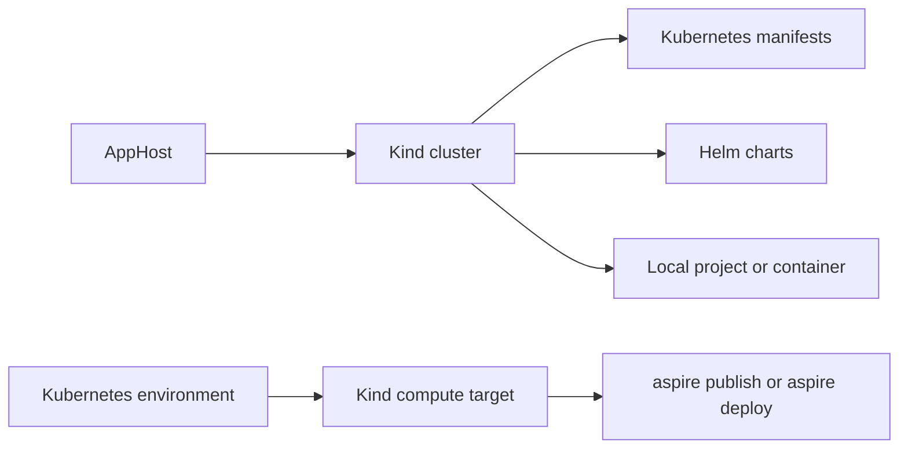

import {
  Aside,
  Badge,
  Steps,
  Tabs,
  TabItem,
} from '@astrojs/starlight/components';
import InstallPackage from '@components/InstallPackage.astro';

<Badge text="⭐ Community Toolkit" variant="tip" size="large" />

[Kind](https://kind.sigs.k8s.io/), short for Kubernetes in Docker, runs Kubernetes clusters in containers. The [Aspire Community Toolkit](https://github.com/CommunityToolkit/Aspire) Kind integration lets your AppHost create a local Kind cluster, deploy Helm charts or Kubernetes manifests, and pass cluster credentials to other resources.

Use the integration to test Kubernetes operators and workloads during local development. It also provides a Kind-backed compute environment for Aspire's `publish` and `deploy` commands.

## Why use Kind with Aspire

- Model the local cluster and its deployed resources in the AppHost.
- View the cluster, Helm charts, and manifests alongside other resources in the Aspire dashboard.
- Configure cluster lifetime so a cluster can either be removed at the end of a session or reused after an AppHost restart.
- Use `WithReference` to pass the kubeconfig and cluster name to projects, executables, and containers.
- Keep Kubernetes resources in local files or inline manifest content and make dependent resources wait for them.

## How the integration fits into an Aspire app

The integration supports two workflows. In the development workflow, the AppHost manages a Kind cluster and optionally deploys resources into it. In the deployment workflow, a Kubernetes environment configured with Kind backs `aspire publish` and `aspire deploy`.



Kind runs its Kubernetes nodes as containers. Kind-managed workloads use Kubernetes networking inside the cluster, which is separate from Aspire's container network. See [Networking and references](/integrations/compute/kind/kind-host/#networking-and-references) before connecting Aspire containers to cluster resources.

## Prerequisites

Install the tools needed for your workflow:

- **Docker or Podman** to run Kind nodes as containers.
- **Kind CLI** available on your `PATH` to create and delete the cluster.
- **kubectl CLI** to add Helm charts or apply manifest resources.
- **Helm CLI** to add Helm chart resources or use the Kind compute environment for deploy scenarios.

Install [Docker](https://docs.docker.com/get-docker/) or [Podman](https://podman.io/docs/installation), [Kind](https://kind.sigs.k8s.io/docs/user/quick-start/#installation), [kubectl](https://kubernetes.io/docs/tasks/tools/), and [Helm](https://helm.sh/docs/intro/install/).

<Aside type="note">
  You only need `kubectl` and Helm for workflows that use manifests, charts, or
  the compute environment. The `kind` command and a supported container runtime
  are required to create a local cluster.
</Aside>

## Add a Kind cluster

Install the [📦 CommunityToolkit.Aspire.Hosting.Kind](https://www.nuget.org/packages/CommunityToolkit.Aspire.Hosting.Kind) package in your AppHost, then add a cluster resource:

<InstallPackage packageName="CommunityToolkit.Aspire.Hosting.Kind" />

<Tabs syncKey='aspire-lang'>
<TabItem id='typescript' label='TypeScript'>

```typescript title="apphost.mts"
import { createBuilder } from './.aspire/modules/aspire.mjs';

const builder = await createBuilder();

await builder.addKindCluster('mycluster');

await builder.build().run();
```

</TabItem>
<TabItem id='csharp' label='C#'>

```csharp title="AppHost.cs"
var builder = DistributedApplication.CreateBuilder(args);

var cluster = builder.AddKindCluster("mycluster");

// After adding all resources, run the app...
builder.Build().Run();
```

</TabItem>
</Tabs>

The integration provisions the cluster when the AppHost starts. By default, it attempts to delete the cluster during graceful shutdown or when its lifecycle hook is disposed. Cleanup is best-effort.

<Steps>

1. [Configure the cluster and add workloads](/integrations/compute/kind/kind-host/). Set the Kubernetes version, worker count, and lifetime, then add Helm charts or manifests if needed.
2. [Reference the cluster from an AppHost resource](/integrations/compute/kind/kind-host/#networking-and-references) to provide its kubeconfig to the resource.
3. Use the Aspire dashboard to inspect the cluster and the status of its chart and manifest resources.

</Steps>

## See also

- [Set up Kind in the AppHost](/integrations/compute/kind/kind-host/)
- [Kind documentation](https://kind.sigs.k8s.io/)
- [Aspire Community Toolkit](https://github.com/CommunityToolkit/Aspire)
