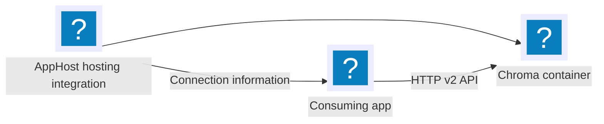

import { Aside, Badge, Steps } from '@astrojs/starlight/components';

<Badge text="⭐ Community Toolkit" variant="tip" size="large" />

:::caution[Package availability]
The Chroma hosting and .NET client integrations are present in the Community Toolkit source, but their packages are not currently published on nuget.org. This documentation describes the APIs verified in that source. Standard NuGet installation cannot be used until packages are published; use an upstream source build if you need to evaluate the integrations before then.
:::

[Chroma](https://www.trychroma.com/) stores embeddings and documents for similarity search. The [Aspire Community Toolkit](https://github.com/CommunityToolkit/Aspire) provides a hosting integration for a Chroma server and a .NET client integration for its v2 API.

## Why use Chroma with Aspire

- Declare a Chroma container in the AppHost and pass its allocated endpoint to consuming apps.
- Persist collections with a named volume or a host-directory bind mount.
- Wait for the server's heartbeat before starting dependent apps.
- Register a singleton .NET client with heartbeat health checks and client-side OpenTelemetry traces and metrics.

## How the pieces fit together

The [📦 CommunityToolkit.Aspire.Hosting.Chroma](https://nuget.org/packages/CommunityToolkit.Aspire.Hosting.Chroma) package runs `chromadb/chroma` in a container. A resource reference supplies a connection string and the server's host, port, and URI to the consuming app.

The [📦 CommunityToolkit.Aspire.Chroma](https://nuget.org/packages/CommunityToolkit.Aspire.Chroma) package registers `ChromaDB.Client.ChromaClient` from ChromaDotNet.Client in a .NET app. Other languages can use the injected URI with their own client or HTTP requests.

<Aside type="note">
  The hosting resource models the server, not individual collections. Create
  collections and insert embeddings through a consuming app. The client uses
  `default_tenant` and `default_database` unless configured otherwise.
</Aside>

## Prerequisites

- Complete the [Aspire prerequisites](/get-started/prerequisites/).
- Start a supported container runtime for the Chroma server.
- Create an AppHost and a consuming app. For the .NET examples, add an ASP.NET Core project named `Api` to the AppHost's project references.

## Set up the integration

<Steps>

1. Install the hosting package in the AppHost and add a resource named `chroma`. Reference it from the consuming app, and configure the app to wait for Chroma. See [Chroma hosting integration](/integrations/databases/chroma/chroma-host/) for runnable AppHost examples and persistence options.

2. Install the client package in a consuming .NET app and register `AddChromaClient("chroma")`. The connection name must match the resource name. See [Connect with the Chroma integration](/integrations/databases/chroma/chroma-connect/) for registration, keyed clients, and examples in other languages.

3. Run the solution with `aspire run`. Inspect the Chroma resource's state and console logs in the dashboard, then call the consuming app.

</Steps>

## See also

- [Chroma documentation](https://docs.trychroma.com/)
- [Chroma hosting integration](/integrations/databases/chroma/chroma-host/)
- [Connect with the Chroma integration](/integrations/databases/chroma/chroma-connect/)
