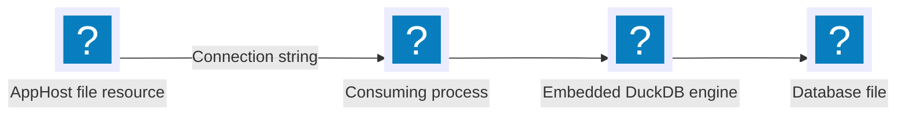

import { Aside, Badge, Steps } from '@astrojs/starlight/components';

<Badge text="⭐ Community Toolkit" variant="tip" size="large" />

[DuckDB](https://duckdb.org/) is an in-process analytical database for SQL queries over local data, including Parquet and CSV files. The [Aspire Community Toolkit](https://github.com/CommunityToolkit/Aspire) provides a hosting resource that describes a database file and a .NET integration that registers an ADO.NET connection.

## Why use DuckDB with Aspire

- Describe the database directory and filename once in the AppHost.
- Pass the same connection string to each app that references the resource.
- Configure a read-only connection for an existing analytical dataset.
- Register scoped or keyed `DuckDBConnection` services with a database health check.

## How the pieces fit together

The [📦 CommunityToolkit.Aspire.Hosting.DuckDB](https://nuget.org/packages/CommunityToolkit.Aspire.Hosting.DuckDB) package models a file resource. It starts no database server or container. The consuming process loads DuckDB and opens the file.

The [📦 CommunityToolkit.Aspire.DuckDB.NET.Data](https://nuget.org/packages/CommunityToolkit.Aspire.DuckDB.NET.Data) package registers `DuckDB.NET.Data.DuckDBConnection` in a .NET app. It reads the connection string supplied by the AppHost.

<Aside type="caution">
  A resource reference passes a file path, not the file itself. The consuming
  process must have access to that path. Plan file mounts separately for
  containerized apps. Follow [DuckDB concurrency
  guidance](https://duckdb.org/docs/stable/connect/concurrency) before opening
  the same file from multiple processes.
</Aside>

## Prerequisites

- Complete the [Aspire prerequisites](/get-started/prerequisites/).
- Create an AppHost and a consuming .NET app. The examples use an ASP.NET Core project named `Api`, referenced by the AppHost.
- Select a writable database directory, or provide an existing file for read-only access.

No container runtime is needed for the DuckDB resource itself.

## Set up the integration

<Steps>

1. Install the hosting package, add a resource named `analytics`, and reference it from the consuming app. See [DuckDB hosting integration](/integrations/databases/duckdb/duckdb-host/) for AppHost examples and file-lifecycle details.

2. Install the client package in the .NET app and register `AddDuckDBConnection("analytics")`. Open the injected connection before executing SQL. See [Connect with the DuckDB integration](/integrations/databases/duckdb/duckdb-connect/).

3. Run `aspire run` and call the consuming app. DuckDB creates a new database file when the first writable connection opens.

</Steps>

## See also

- [DuckDB documentation](https://duckdb.org/docs/stable/)
- [DuckDB.NET](https://github.com/Giorgi/DuckDB.NET)
- [DuckDB hosting integration](/integrations/databases/duckdb/duckdb-host/)
- [Connect with the DuckDB integration](/integrations/databases/duckdb/duckdb-connect/)
