import { Aside, Badge, Steps } from '@astrojs/starlight/components';
import InstallPackage from '@components/InstallPackage.astro';

<Badge text="⭐ Community Toolkit" variant="tip" size="large" />

[Flyway](https://flywaydb.org/) manages database schema changes by applying versioned migration scripts. The Community Toolkit hosting integration runs Flyway in a container and mounts your migration directory into it. Use it with a database resource and the Flyway extension for that database provider.

## Why use Flyway with Aspire

- Model migrations alongside the database they update.
- Keep migration files in your application repository and mount them read-only into Flyway.
- Let Aspire manage the Flyway container's lifecycle and show its logs and state in the dashboard.

## Prerequisites

- .NET 10 or later and the [Aspire CLI](/get-started/install-cli/).
- Docker to run the Flyway and database containers.
- A database resource and the matching database-specific Flyway extension for connection configuration.

## How the integration fits together

The AppHost declares a Flyway container and provides a host directory containing SQL migration files. Flyway reads those files from `/flyway/sql`. This package provides the generic Flyway resource; configure the target database through the extension supplied for that database provider.

```mermaid
architecture-beta
  group apphost(server)[AppHost]
  service flyway(resource)[Flyway resource] in apphost
  service database(database)[Database resource] in apphost
  service scripts(disk)[Migration scripts]
  scripts:R --> L:flyway
  flyway:R --> L:database
```

## Start using Flyway

<Steps>

1. Install the hosting package in the AppHost.

   <InstallPackage
     packageName="CommunityToolkit.Aspire.Hosting.Flyway"
     shortName="flyway"
   />

2. Add a `migrations` directory to the AppHost project and put Flyway-formatted migration files in it.

3. Add a Flyway resource and the database-specific extension to your AppHost. See [Configure Flyway in the AppHost](/integrations/databases/flyway/flyway-host/) for the complete API and a minimal resource example.

</Steps>

<Aside type="note">
  Adding a generic Flyway resource mounts migration scripts and sets Flyway's
  script location. It does not by itself configure database credentials or
  choose a database engine. Use the provider-specific extension for that
  behavior.
</Aside>

## See also

- [Configure Flyway in the AppHost](/integrations/databases/flyway/flyway-host/)
- [Flyway documentation](https://documentation.red-gate.com/flyway)
- [📦 CommunityToolkit.Aspire.Hosting.Flyway](https://www.nuget.org/packages/CommunityToolkit.Aspire.Hosting.Flyway)
