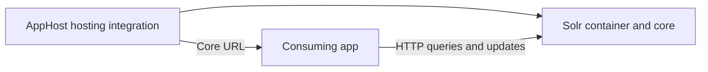

import { Aside, Badge, Steps } from '@astrojs/starlight/components';

<Badge text="⭐ Community Toolkit" variant="tip" size="large" />

:::caution[Prerelease integration]
The Solr hosting package is currently available as `13.6.2-beta.959`, with no stable release. Select that prerelease explicitly when installing the package. See [Solr installation](/integrations/databases/solr/solr-host/#installation) for the package reference.
:::

[Apache Solr](https://solr.apache.org/) is a search platform built on Apache Lucene. The [Aspire Community Toolkit](https://github.com/CommunityToolkit/Aspire) hosting integration runs a Solr container, creates a core, and supplies the core's HTTP URL to apps that reference it.

## Why use Solr with Aspire

- Start a local search service with a core configured by the AppHost.
- Use a custom configset to define the core's schema and search behavior.
- Persist indexes and configuration with a volume or bind mount.
- Check the core's ping endpoint before starting dependent apps.

## How the pieces fit together

Install [📦 CommunityToolkit.Aspire.Hosting.Solr](https://nuget.org/packages/CommunityToolkit.Aspire.Hosting.Solr) in the AppHost. Each resource runs a Solr container with one core selected at creation. A reference passes the core URL, host, port, and core name to the consuming app.

<Aside type="note">
  This group contains a hosting package, not a Community Toolkit Solr client
  package. Use an HTTP client or a Solr library in the consuming app. Client
  dependency injection, retries, and telemetry remain application concerns.
</Aside>

## Prerequisites

- Complete the [Aspire prerequisites](/get-started/prerequisites/).
- Start a supported container runtime.
- Create an AppHost and a consuming app. The .NET walkthrough uses an ASP.NET Core project named `Api`, referenced by the AppHost.
- Prepare a valid Solr configset directory if the app needs a custom schema.

## Set up the integration

<Steps>

1. Install the hosting package and add a resource named `solr`. Select a core name, then reference the resource from the consuming app and wait for it. See [Solr hosting integration](/integrations/databases/solr/solr-host/) for runnable AppHost examples.

2. Read `ConnectionStrings:solr` in .NET, or `ConnectionStrings__solr` in other languages. The value already includes `/solr/{coreName}`. See [Connect with the Solr integration](/integrations/databases/solr/solr-connect/) for complete HTTP examples.

3. Run `aspire run`. Open the Solr HTTP endpoint from the dashboard to inspect the administration UI, then query the core from the consuming app.

</Steps>

## See also

- [Solr reference guide](https://solr.apache.org/guide/solr/latest/)
- [Solr hosting integration](/integrations/databases/solr/solr-host/)
- [Connect with the Solr integration](/integrations/databases/solr/solr-connect/)
