import { Aside, Badge, Tabs, TabItem } from '@astrojs/starlight/components';

<Badge text="⭐ Community Toolkit" variant="tip" size="large" />

[Umami](https://umami.is/) is a self-hosted web analytics platform. The Aspire Community Toolkit integration adds an Umami container to your AppHost and configures it to use an Aspire PostgreSQL database.

## Why use Umami with Aspire

The hosting integration:

- Models Umami and its PostgreSQL database as AppHost resources.
- Configures Umami's database URL and waits for the database before starting Umami.
- Creates a secret parameter for Umami when you don't provide one.
- Adds an HTTP health check for Umami.

## How the integration fits together

The hosting package runs Umami alongside PostgreSQL. Open Umami's HTTP endpoint from the Aspire dashboard to use its web interface.

```mermaid
architecture-beta

  group apphost(iconoir:network)[AppHost]

  service hosting(iconoir:puzzle)[Umami integration] in apphost
  service umami(iconoir:database-stats)[Umami] in apphost
  service postgres(logos:postgresql)[PostgreSQL] in apphost

  hosting:R --> L:umami
  postgres:R --> L:umami
```



## Prerequisites

- Install the [Aspire CLI](/get-started/install-cli/) and create an AppHost.
- Install and run Docker, which Aspire uses to start the Umami and PostgreSQL containers.
- Add the Umami hosting package to the AppHost.

## Run Umami in the AppHost

Add a PostgreSQL database and configure Umami to use it:

<Tabs syncKey="aspire-lang">
<TabItem id="typescript" label="TypeScript">

```typescript title="apphost.mts"
import { createBuilder } from './.aspire/modules/aspire.mjs';

const builder = await createBuilder();

const postgres = await builder.addPostgres('postgres');
const database = await postgres.addDatabase('umami-db');

const umami = await builder.addUmami('umami');
await umami.withPostgreSQL(database);

await builder.build().run();
```

</TabItem>
<TabItem id="csharp" label="C#">

```csharp title="AppHost.cs"
var builder = DistributedApplication.CreateBuilder(args);

var postgres = builder.AddPostgres("postgres");
var database = postgres.AddDatabase("umami-db");

var umami = builder.AddUmami("umami")
    .WithPostgreSQL(database);

// After adding all resources, run the app...
builder.Build().Run();
```

</TabItem>
</Tabs>

The integration creates an Umami resource using the `umamisoftware/umami:3.4` container image. Aspire exposes its HTTP endpoint in the dashboard. For package installation, resource options, and health-check behavior, see [Set up Umami in the AppHost](/integrations/devtools/umami/umami-host/).

<Aside type="note">
  The hosting integration does not provide a consuming-app client package. Use
  Umami's HTTP endpoint when configuring your website to send analytics to this
  instance.
</Aside>

## See also

- [Set up Umami in the AppHost](/integrations/devtools/umami/umami-host/)
- [Umami documentation](https://umami.is/docs)
- [Aspire Community Toolkit](https://github.com/CommunityToolkit/Aspire)
