import { Image } from 'astro:assets';
import {
  Aside,
  Badge,
  LinkButton,
  Tabs,
  TabItem,
} from '@astrojs/starlight/components';
import flareIcon from '@assets/icons/flare-icon.png';

<Badge text="⭐ Community Toolkit" variant="tip" size="large" />

<Image
  src={flareIcon}
  alt="Flare logo"
  width={100}
  height={100}
  class:list={'float-inline-left icon'}
  data-zoom-off
/>

[Flare](https://github.com/aminparsa18/Flare.Net) is a self-hosted, OpenTelemetry-native observability backend for logs, traces, and metrics, with alert rules that notify Slack, webhooks, email, PagerDuty, and other channels. Applications send plain OTLP to it with the standard OpenTelemetry SDK. The Community Toolkit integration adds the Flare services to an Aspire AppHost and points your resources' OpenTelemetry exporters at it.

## Why use Flare with Aspire

The Aspire dashboard shows telemetry for the current run. Use Flare when you need more than that:

- Telemetry is stored in ClickHouse, so it persists across AppHost runs.
- Alert rules evaluate log, metric, and exception queries and send notifications.
- The same backend is part of your app model, so `aspire publish` and `aspire deploy` carry it to Docker Compose or Kubernetes.

## Prerequisites

- An Aspire AppHost project. See the [hosting integration reference](/integrations/observability/flare/flare-host/) for installation instructions.
- Docker or another configured container runtime. Flare runs from the `docker.io/apardev/flare-*` container images.
- A [ClickHouse](/integrations/databases/clickhouse/clickhouse-get-started/) server resource and a [Redis](/integrations/caching/redis/redis-get-started/) resource in the AppHost. Flare stores telemetry in ClickHouse and uses Redis as a buffer in front of it.

## How it works

`AddFlare` adds four containers. The `flare` resource is the OTLP ingest service, on the conventional ports `4317` for gRPC and `4318` for HTTP. The query API, alert worker, and dashboard appear under it in the Aspire dashboard as `flare-api`, `flare-alert-worker`, and `flare-dashboard`.

```mermaid
architecture-beta

  group apphost(iconoir:network)[AppHost]

  service app(iconoir:code)[Application] in apphost
  service ingest(iconoir:import)[Flare ingest] in apphost
  service redis(logos:redis)[Redis] in apphost
  service clickhouse(aspire:clickhouse)[ClickHouse] in apphost
  service api(iconoir:server)[Flare API] in apphost
  service dashboard(iconoir:graph-up)[Flare dashboard] in apphost

  app:R --> L:ingest
  ingest:R --> L:redis
  redis:R --> L:clickhouse
  clickhouse:B --> T:api
  api:L --> R:dashboard
```



You pass the ClickHouse and Redis resources in, so they stay visible and configurable in your app model. Flare creates its own database inside the ClickHouse server, and the Flare images migrate their own schema on startup.

<Aside type="note">
  A resource that sends telemetry to Flare no longer sends it to the Aspire
  dashboard. The dashboard still shows the resource, its console output, and its
  state. To see the same telemetry in both, export to an [OpenTelemetry
  Collector](/integrations/observability/opentelemetry-collector/opentelemetry-collector-get-started/)
  that forwards to each.
</Aside>

## Get started

Add Flare on top of a ClickHouse server and a Redis resource, then send a project's telemetry to it. This example assumes the AppHost has an `Api` project:

<Tabs syncKey="aspire-lang">
<TabItem id="typescript" label="TypeScript">

```typescript title="apphost.mts"
import { createBuilder } from './.aspire/modules/aspire.mjs';

const builder = await createBuilder();

const clickhouse = await builder.addClickHouse('clickhouse');
const redis = await builder.addRedis('redis');

const flare = await builder.addFlare('flare', clickhouse, redis);
await flare.withDataVolume();

const api = await builder.addDotnetProject('api', '../Api/Api.csproj');
await api.withFlareOtlpExporter(flare);
await api.waitFor(flare);

// After adding all resources, run the app...
await builder.build().run();
```

</TabItem>
<TabItem id="csharp" label="C#">

```csharp title="AppHost.cs"
var builder = DistributedApplication.CreateBuilder(args);

var clickhouse = builder.AddClickHouse("clickhouse");
var redis = builder.AddRedis("redis");

var flare = builder.AddFlare("flare", clickhouse, redis)
    .WithDataVolume();

builder.AddDotnetProject("api", "../Api/Api.csproj")
    .WithOtlpExporter(flare)
    .WaitFor(flare);

// After adding all resources, run the app...
builder.Build().Run();
```

</TabItem>
</Tabs>

The exporter call sets `OTEL_EXPORTER_OTLP_ENDPOINT` and `OTEL_EXPORTER_OTLP_PROTOCOL` on the project. A project that uses the standard Aspire service defaults sends its logs, traces, and metrics to Flare with no code change. Open the `flare-dashboard` resource's URL to see them.

The [Flare hosting integration](/integrations/observability/flare/flare-host/) documents installation, persistence, ingest API keys, publishing, and the full AppHost API.

<LinkButton
  variant="secondary"
  iconPlacement="end"
  icon="right-arrow"
  href="/integrations/observability/flare/flare-host/"
>
  Set up Flare in the AppHost
</LinkButton>

## See also

- [Flare documentation](https://github.com/aminparsa18/Flare.Net/tree/main/docs)
- [Flare hosting integration](/integrations/observability/flare/flare-host/)
- [Aspire Community Toolkit Flare integration source](https://github.com/CommunityToolkit/Aspire/tree/main/src/CommunityToolkit.Aspire.Hosting.Flare)
