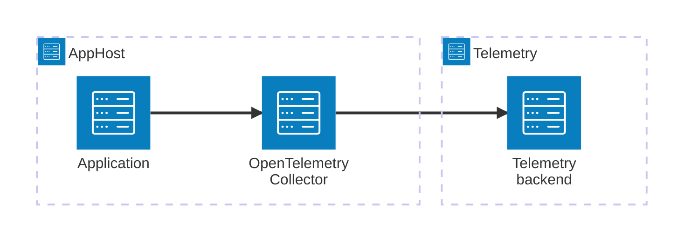

import {
  Aside,
  Badge,
  LinkButton,
  Tabs,
  TabItem,
} from '@astrojs/starlight/components';

<Badge text="⭐ Community Toolkit" variant="tip" size="large" />

The [OpenTelemetry Collector](https://opentelemetry.io/docs/collector/) receives, processes, and exports telemetry. The Community Toolkit integration adds a Collector container to an Aspire AppHost and routes telemetry from selected resources, or from all compatible resources, to it.

## Why use the Collector integration

Use the integration to run a Collector alongside your application during development and manage telemetry routing from the AppHost. Configure the Collector with your own receivers, processors, and exporters, then choose which Aspire resources send telemetry to it.

The package provides two routing options:

- Route one resource with `WithOpenTelemetryCollectorRouting`.
- Use `WithAppForwarding` to route all resources that have an OpenTelemetry exporter annotation.

## Prerequisites

- An Aspire AppHost project with the Community Toolkit package installed. See the [hosting integration reference](/integrations/observability/opentelemetry-collector/opentelemetry-collector-host/) for installation instructions.
- Docker or another configured container runtime for running the Collector container.
- A Collector configuration file that defines the OTLP receiver and the exporters you want to use.

## How it works

The hosting integration creates the Collector container and exposes its OTLP gRPC and HTTP endpoints. Routing configures `OTEL_EXPORTER_OTLP_ENDPOINT` on each selected resource and waits for the Collector's health check before starting it.



<Aside type="note">
  The AppHost integration routes telemetry but does not configure the
  Collector's pipelines. Provide a Collector configuration file that defines the
  receivers and exporters your application needs.
</Aside>

## Get started

Add a Collector resource and route an application to it. This example assumes the AppHost has an `Api` project and an `otel-collector-config.yaml` file:

<Tabs syncKey="aspire-lang">
<TabItem id="typescript" label="TypeScript">

```typescript title="apphost.mts"
import { createBuilder } from './.aspire/modules/aspire.mjs';

const builder = await createBuilder();

const collector = await builder.addOpenTelemetryCollector('otel-collector');
await collector.withConfig('./otel-collector-config.yaml');

const api = await builder.addProject('api', '../Api/Api.csproj');
await api.withOpenTelemetryCollectorRouting(collector);

// After adding all resources, run the app...
await builder.build().run();
```

</TabItem>
<TabItem id="csharp" label="C#">

```csharp title="AppHost.cs"
var builder = DistributedApplication.CreateBuilder(args);

var collector = builder.AddOpenTelemetryCollector("otel-collector")
    .WithConfig("./otel-collector-config.yaml");

builder.AddProject<Projects.Api>("api")
    .WithOpenTelemetryCollectorRouting(collector);

// After adding all resources, run the app...
builder.Build().Run();
```

</TabItem>
</Tabs>

The [OpenTelemetry Collector hosting integration](/integrations/observability/opentelemetry-collector/opentelemetry-collector-host/) documents installation, automatic forwarding, settings, endpoints, and health checks. See the [OpenTelemetry Collector configuration documentation](https://opentelemetry.io/docs/collector/configuration/) for pipeline configuration options.

<LinkButton
  variant="secondary"
  iconPlacement="end"
  icon="right-arrow"
  href="/integrations/observability/opentelemetry-collector/opentelemetry-collector-host/"
>
  Set up the Collector in the AppHost
</LinkButton>

## See also

- [OpenTelemetry Collector documentation](https://opentelemetry.io/docs/collector/)
- [OpenTelemetry Collector hosting integration](/integrations/observability/opentelemetry-collector/opentelemetry-collector-host/)
