import { Aside, Badge, Tabs, TabItem } from '@astrojs/starlight/components';
import InstallPackage from '@components/InstallPackage.astro';
import ThemeImage from '@components/ThemeImage.astro';
import ngrokIcon from '@assets/icons/ngrok-icon.png';
import ngrokLightIcon from '@assets/icons/ngrok-light-icon.png';

<Badge text="⭐ Community Toolkit" variant="tip" size="large" />

<ThemeImage
  light={ngrokLightIcon}
  dark={ngrokIcon}
  alt="ngrok logo"
  width={100}
  height={100}
  zoomable={false}
  classOverride="float-inline-left icon"
/>

[ngrok](https://ngrok.com/) creates public endpoints that forward traffic to services running in a development environment. The Aspire Ngrok integration from the [Aspire Community Toolkit](https://github.com/CommunityToolkit/Aspire) adds an ngrok container to your AppHost and configures it to tunnel selected resource endpoints.

Use the integration to share a development endpoint or receive requests from external systems, such as a webhook sender. The ngrok URL is created by ngrok or supplied as a reserved URL. This integration configures and runs the tunnel; consuming apps do not use a separate Aspire client integration to connect to it.

## Why use Ngrok with Aspire

- Declare ngrok and its upstream endpoints alongside the rest of the distributed application in the AppHost.
- Keep authentication tokens in Aspire secret parameters rather than AppHost source code.
- Use ngrok's inspection API to find the public URL and upstream address for each configured tunnel.

## How it works

The AppHost declares the service endpoint to expose and an ngrok resource. At startup, the integration writes an ngrok configuration file and starts the ngrok container with the configured upstream endpoints.

```mermaid
architecture-beta

  group apphost(iconoir:network)[AppHost]

  service apiService(iconoir:code)[Application service] in apphost
  service ngrok(logos:ngrok)[ngrok container] in apphost

  service external(cloud)[External caller]

  apiService:R --> L:ngrok
  external:R --> L:ngrok
```



The tunnel forwards requests from ngrok's public URL to the selected service endpoint. You can query the ngrok container's local inspection API to find the resulting public URL.

## Prerequisites

- An Aspire AppHost project with Docker available to run the ngrok container.
- An ngrok account and a valid authentication token. Store the token as a secret parameter instead of adding it to source control.

Install the hosting package in your AppHost project:

<InstallPackage packageName="CommunityToolkit.Aspire.Hosting.Ngrok" />

## Set up Ngrok in the AppHost

With the package installed, add a tunnel for an application endpoint:

<Tabs syncKey="aspire-lang">
<TabItem id="typescript" label="TypeScript">

```typescript title="apphost.mts"
import { createBuilder } from './.aspire/modules/aspire.mjs';

const builder = await createBuilder();

const authToken = await builder.addParameter('ngrok-auth-token', {
  secret: true,
});
const api = await builder.addProject('api', '../Api/Api.csproj');

const ngrok = await builder.addNgrok('ngrok');
await ngrok.withAuthToken(authToken);
await ngrok.withTunnelEndpoint(api, 'http');

await builder.build().run();
```

</TabItem>
<TabItem id="csharp" label="C#">

```csharp title="AppHost.cs"
var builder = DistributedApplication.CreateBuilder(args);

var authToken = builder.AddParameter("ngrok-auth-token", secret: true);
var api = builder.AddProject<Projects.Api>("api");

builder.AddNgrok("ngrok")
    .WithAuthToken(authToken)
    .WithTunnelEndpoint(api, "http");

// After adding all resources, run the app...
builder.Build().Run();
```

</TabItem>
</Tabs>

The `WithTunnelEndpoint` call uses the AppHost resource name and endpoint name to select the upstream. Omitting a custom ngrok URL lets ngrok assign one.

<Aside type="note">
  The Ngrok integration has no consuming-app client integration. Configure
  tunnels in the AppHost, then use the public URL reported by ngrok when you
  need to call the exposed service from outside the development environment.
</Aside>

## Next steps

Follow [Host services with the Ngrok integration](/integrations/reverse-proxies/ngrok/ngrok-host/) to review the available resource configuration, endpoints, and API options.

## See also

- [Ngrok integration for Aspire](https://learn.microsoft.com/dotnet/aspire/community-toolkit/ngrok)
- [ngrok documentation](https://ngrok.com/docs)
- [Aspire Community Toolkit](https://github.com/CommunityToolkit/Aspire)
