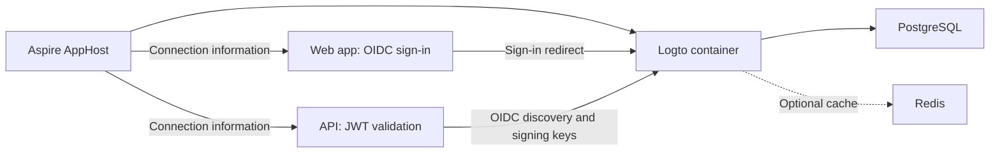

import {
  Aside,
  Badge,
  Steps,
  Tabs,
  TabItem,
} from '@astrojs/starlight/components';
import InstallPackage from '@components/InstallPackage.astro';

<Badge text="⭐ Community Toolkit" variant="tip" size="large" />

[Logto](https://logto.io/) is an identity platform that supports OpenID Connect (OIDC) sign-in and access-token authentication. The [Aspire Community Toolkit](https://github.com/CommunityToolkit/Aspire) provides a hosting integration to run Logto with PostgreSQL and a .NET client integration to configure ASP.NET Core authentication.

## Why use Logto with Aspire

- Model the identity server and its PostgreSQL dependency in the AppHost. The hosting integration supplies the database URL and waits for PostgreSQL.
- Add Redis when Logto needs caching, and persist container data with volumes or bind mounts.
- Check server readiness through Logto's `/api/status` endpoint.
- Pass the Logto endpoint to consuming apps through a resource reference instead of maintaining separate connection strings.
- Configure browser sign-in and API token validation with the .NET client package.

## How the pieces fit together



The hosting package creates a `LogtoResource` with a primary HTTP endpoint and an Admin Console endpoint. Referencing that resource supplies its primary endpoint to a consuming app. The client package configures authentication handlers; it doesn't register a general-purpose Logto Management API client.

Application registration is separate from orchestration. Create a traditional web application in the Logto Admin Console for browser sign-in. For an API, register an API resource and use its identifier as the accepted token audience.

## Prerequisites

- An [Aspire development environment](/get-started/prerequisites/) with a supported container runtime.
- An AppHost and an ASP.NET Core web or API project to reference.
- Access to the Logto Admin Console to register applications and API resources after startup.

## Set up a local Logto instance

Install [📦 CommunityToolkit.Aspire.Hosting.Logto](https://nuget.org/packages/CommunityToolkit.Aspire.Hosting.Logto) in the AppHost:

<InstallPackage packageName="CommunityToolkit.Aspire.Hosting.Logto" />

The hosting package depends on the PostgreSQL and Redis hosting integrations. Its exported APIs support both TypeScript and C# AppHosts. After installing the package, regenerate the TypeScript AppHost bindings through the Aspire CLI before using the examples.

<Steps>

1.  Add PostgreSQL and Logto to the AppHost. Enable database seeding for this initial local setup:

          <Tabs syncKey="aspire-lang">

    <TabItem id="typescript" label="TypeScript">

    ```typescript title="apphost.mts"
    import { createBuilder } from './.aspire/modules/aspire.mjs';

    const builder = await createBuilder();

    const postgres = await builder.addPostgres('postgres');
    const logto = await builder.addLogto('logto', postgres);
    await logto.withDatabaseSeeding();

    const web = await builder.addProject('web', '../Web/Web.csproj');
    await web.withReference(logto);
    await web.waitFor(logto);

    await builder.build().run();
    ```

          </TabItem>

    <TabItem id="csharp" label="C#">

    ```csharp title="AppHost.cs"
    var builder = DistributedApplication.CreateBuilder(args);

    var postgres = builder.AddPostgres("postgres");
    var logto = builder.AddLogto("logto", postgres)
        .WithDatabaseSeeding();

    builder.AddProject<Projects.Web>("web")
        .WithReference(logto)
        .WaitFor(logto);

    // After adding all resources, run the app...
    builder.Build().Run();
    ```

          </TabItem>

    </Tabs>

    Use the path or project type for your consuming project in place of `Web`.

2.  Run `aspire run`. Open the `admin` endpoint for the `logto` resource in the Aspire dashboard. Complete the Logto setup and create the application or API resource your consuming app needs.

3.  Configure the consuming app with `AddLogtoOIDC("logto")` for browser sign-in or `AddLogtoJwtBearer("logto", ...)` for API access-token validation. Follow the [connection guide](/integrations/security/logto/logto-connect/) for required settings and complete .NET examples.

</Steps>

<Aside type="caution">
  Database seeding is opt-in. It changes container startup to run `npm run cli
  db seed -- --swe && npm start` each time the container starts. Choose an
  initialization and migration process appropriate to your environment before
  using this startup mode with existing data.
</Aside>

## Choose a flow

- [Logto hosting integration](/integrations/security/logto/logto-host/): configure ports, PostgreSQL, Redis, persistence, environment settings, and hosting health checks.
- [Logto client integration](/integrations/security/logto/logto-connect/): consume connection properties, configure OIDC or JWT authentication, and connect from other languages.

## See also

- [Logto documentation](https://docs.logto.io/)
- [Logto integration examples](https://github.com/CommunityToolkit/Aspire/tree/main/examples/logto)
- [Aspire Community Toolkit](https://github.com/CommunityToolkit/Aspire)
