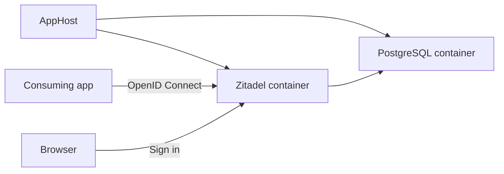

import {
  Aside,
  Badge,
  Steps,
  Tabs,
  TabItem,
} from '@astrojs/starlight/components';
import InstallPackage from '@components/InstallPackage.astro';

<Badge text="⭐ Community Toolkit" variant="tip" size="large" />

[Zitadel](https://zitadel.com/docs) is an identity and access management service that supports OpenID Connect, OAuth 2.0, and SAML. The [Aspire Community Toolkit](https://github.com/CommunityToolkit/Aspire) hosting integration runs a Zitadel container and configures its PostgreSQL dependency in your AppHost.

Use this integration to develop applications against a local identity provider. It configures the first administrator account, exposes the server endpoint, and reports server health in the Aspire dashboard.

## Why use Zitadel with Aspire

- Declare Zitadel and PostgreSQL together instead of maintaining separate container startup scripts.
- Pass database credentials and allocated endpoints through resource references.
- Generate an administrator password and master key, or supply secret parameters.
- Wait for PostgreSQL before starting Zitadel, and wait for Zitadel's health check before starting consumers.
- Use the exported hosting APIs from either a TypeScript or C# AppHost.

## How the pieces fit together



The hosting package belongs in the AppHost. PostgreSQL stores Zitadel's data, and Zitadel initializes the database when it starts. Your application uses an OpenID Connect library to authenticate users against the Zitadel endpoint.

<Aside type="note">
  This is a hosting integration, not an authentication client integration. It
  does not register application-side authentication services, create OIDC
  application registrations, or expose a Zitadel connection string. See [Connect
  to Zitadel](/integrations/security/zitadel/zitadel-connect/) for the endpoint
  handoff and client configuration.
</Aside>

## Prerequisites

- An Aspire AppHost. Follow [Set up your environment](/get-started/prerequisites/) if needed.
- A running container runtime for the Zitadel and PostgreSQL containers.
- The [📦 CommunityToolkit.Aspire.Hosting.Zitadel](https://nuget.org/packages/CommunityToolkit.Aspire.Hosting.Zitadel) hosting package.
- The [📦 Aspire.Hosting.PostgreSQL](https://nuget.org/packages/Aspire.Hosting.PostgreSQL) hosting package for the database examples.

## Run Zitadel locally

<Steps>

1.  Install the hosting packages in your AppHost:

    <InstallPackage
      packageName="CommunityToolkit.Aspire.Hosting.Zitadel"
      shortName="zitadel"
    />

    <InstallPackage
      packageName="Aspire.Hosting.PostgreSQL"
      shortName="postgres"
    />

    For a TypeScript AppHost, installation generates the integration bindings in `./.aspire/modules/aspire.mjs`.

2.  Add PostgreSQL and attach it to Zitadel:

          <Tabs syncKey='aspire-lang'>

    <TabItem id='typescript' label='TypeScript'>

    ```typescript title="apphost.mts"
    import { createBuilder } from './.aspire/modules/aspire.mjs';

    const builder = await createBuilder();

    const postgres = await builder.addPostgres('postgres');
    const zitadel = await builder.addZitadel('zitadel', { port: 8080 });
    await zitadel.withDatabase(postgres);

    await builder.build().run();
    ```

          </TabItem>

    <TabItem id='csharp' label='C#'>

    ```csharp title="AppHost.cs"
    var builder = DistributedApplication.CreateBuilder(args);

    var postgres = builder.AddPostgres("postgres");
    var zitadel = builder.AddZitadel("zitadel", port: 8080)
        .WithDatabase(postgres);

    // After adding all resources, run the app...
    builder.Build().Run();
    ```

          </TabItem>

    </Tabs>

    The database helper adds a database named `zitadel-db`, supplies PostgreSQL settings to Zitadel, and adds a database reference and startup dependency. Port `8080` is the host port; the container also listens on port `8080`.

3.  Run the AppHost with `aspire run`. Wait for Zitadel to become healthy, then open the **Zitadel Dashboard** endpoint from the Aspire dashboard. Retrieve the initial credentials from the AppHost's parameter values. The default username is `admin`, and the password is generated.

</Steps>

<Aside type="tip">
  Use a stable host port for local OIDC development. Configure clients with the
  actual endpoint URL shown by Aspire, including its scheme. Certificate
  configuration can change the endpoint to HTTPS even though its name remains
  `http`.
</Aside>

## Next steps

- [Set up the Zitadel hosting integration](/integrations/security/zitadel/zitadel-host/) for database selection, secrets, external domains, persistence, and TLS behavior.
- [Connect to Zitadel](/integrations/security/zitadel/zitadel-connect/) to pass an authority URL to an application and configure OpenID Connect.

## See also

- [Zitadel documentation](https://zitadel.com/docs)
- [PostgreSQL hosting integration](/integrations/databases/postgres/postgres-host/)
- [Community Toolkit Zitadel source and README](https://github.com/CommunityToolkit/Aspire/tree/main/src/CommunityToolkit.Aspire.Hosting.Zitadel)
