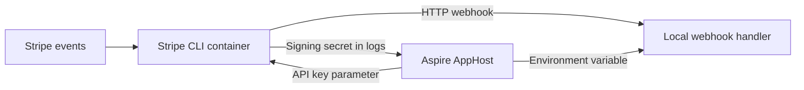



[Stripe](https://stripe.com/) provides payment APIs and sends webhook events when payment activity occurs. The [Aspire Community Toolkit](https://github.com/CommunityToolkit/Aspire) integration runs the Stripe CLI in a container so that you can forward events to a local webhook handler during development.

The [📦 CommunityToolkit.Aspire.Hosting.Stripe](https://nuget.org/packages/CommunityToolkit.Aspire.Hosting.Stripe) package configures the CLI listener in your AppHost. It also extracts the webhook signing secret from the listener's logs and provides an AppHost reference API to pass that secret to your application.

:::note
This is a local-development CLI integration. It does not host the Stripe
payment service, provision production webhook endpoints, or register a Stripe
SDK client in your application. The CLI resource is excluded from the
application manifest.
:::

## Why use Stripe with Aspire

- Start the webhook listener alongside the application's other resources.
- Configure the forwarding destination and event filters in the AppHost.
- Supply the API key through an Aspire secret parameter rather than putting it in source code.
- Pass the listener's webhook signing secret to resources that support environment variables.
- Inspect the CLI's output in the Aspire dashboard when troubleshooting forwarding.

## How the pieces fit together



The AppHost starts `docker.io/stripe/stripe-cli` with the API key in `STRIPE_API_KEY`. Configuring a listener adds `listen --forward-to <url>`, with an optional event filter. The integration watches the CLI's logs for a `whsec_` signing secret.

Reference the listener from the application that verifies webhooks to inject `STRIPE_WEBHOOK_SECRET`. This is a custom environment variable, not an Aspire connection string. The application remains responsible for receiving HTTP requests and verifying their signatures.

## Prerequisites

- Set up an [Aspire AppHost](/get-started/app-host/) and a container runtime using the [Aspire prerequisites](/get-started/prerequisites/).
- Obtain a Stripe test API key for your account.
- Provide a local HTTP webhook handler whose address is reachable from the Stripe CLI container.
- Install the [Stripe CLI](https://docs.stripe.com/stripe-cli) on the host if you want to trigger test events from a terminal. The AppHost listener itself uses the container image, not the host executable.

## Start a webhook listener


1.  **Install the hosting integration.**

    

    For a TypeScript AppHost, installation adds the package to `aspire.config.json` and generates its APIs in `.aspire/modules/aspire.mjs`. The package exports both listener overloads and the webhook-secret reference API.

2.  **Store the API key as a secret.**

    Configure `Parameters:stripe-api-key` in the AppHost's secret store:

    ```bash title="Terminal"
    aspire secret set Parameters:stripe-api-key <your-stripe-test-api-key>
    ```

    The examples declare the parameter with `secret: true` and do not supply a key in source code.

3.  **Add the forwarding destination and listener.**

    The following example forwards events to an existing webhook handler at port `5082`. On Docker Desktop, `host.docker.internal` addresses the host from inside the container. Use a base address appropriate to your container runtime and bind the handler to an interface that accepts those requests.

          

```typescript title="apphost.mts"
import { createBuilder } from './.aspire/modules/aspire.mjs';

const builder = await createBuilder();

const apiKey = await builder.addParameter('stripe-api-key', {
  secret: true,
});
const webhookEndpoint = await builder.addExternalService(
  'webhook-endpoint',
  'http://host.docker.internal:5082'
);

const stripe = await builder.addStripe('stripe', apiKey);
await stripe.withListenExternalService(webhookEndpoint, {
  webhookPath: 'webhooks/stripe',
  events: ['payment_intent.created', 'charge.succeeded'],
});

await builder.build().run();
```



```csharp title="AppHost.cs"
var builder = DistributedApplication.CreateBuilder(args);

var apiKey = builder.AddParameter("stripe-api-key", secret: true);
var webhookEndpoint = builder.AddExternalService(
    "webhook-endpoint",
    "http://host.docker.internal:5082");

var stripe = builder.AddStripe("stripe", apiKey)
    .WithListen(
        webhookEndpoint,
        webhookPath: "webhooks/stripe",
        events: ["payment_intent.created", "charge.succeeded"]);

// After adding all resources, run the app...
builder.Build().Run();
```



    A literal external-service URI is normalized with a trailing slash. The path in this example omits its leading slash because the integration concatenates the URI and path directly.

4.  **Start the AppHost and test webhook verification.**

    ```bash title="Terminal"
    aspire run
    ```

    For an application managed by the AppHost, use the [webhook-secret reference API](/integrations/cloud/stripe/stripe-host/#pass-the-webhook-signing-secret-to-an-application). For a separately started handler, obtain the listener's signing secret from its startup logs and configure it in that application's own secret store.

    Verify signatures using the unmodified request body, the `Stripe-Signature` header, and the signing secret. Follow [Stripe's webhook signature guidance](https://docs.stripe.com/events/manage-webhook-endpoints#signature-errors).

    With the host CLI authenticated to the same Stripe account, trigger an event:

    ```bash title="Terminal"
    stripe trigger payment_intent.created
    ```

    Check the listener's dashboard logs and the handler's response. Triggering events requires the host CLI to be authenticated separately from the container listener.


:::caution
`localhost` inside the CLI container refers to that container, not the host
machine. Check that the forwarding URL is reachable from the container.
Resource startup alone does not confirm webhook delivery or successful
signature verification.
:::

## Next steps

See the [Stripe CLI hosting reference](/integrations/cloud/stripe/stripe-host/) for forwarding to an Aspire resource, filtering events, configuring API keys, customizing the secret environment variable, and understanding startup behavior.

## See also

- [Stripe CLI documentation](https://docs.stripe.com/stripe-cli)
- [Test webhook endpoints locally](https://docs.stripe.com/webhooks#local-listener)
- [Stripe integration source and README](https://github.com/CommunityToolkit/Aspire/tree/main/src/CommunityToolkit.Aspire.Hosting.Stripe)
