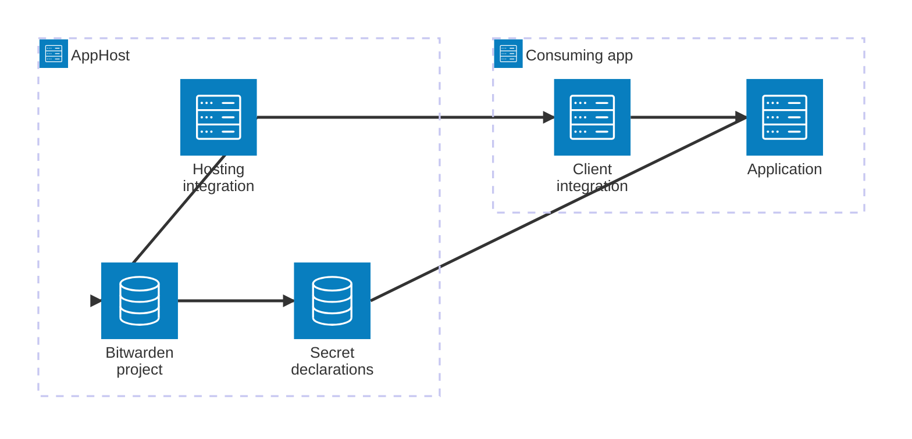



[Bitwarden Secrets Manager](https://bitwarden.com/products/secrets-manager/) stores machine credentials in projects. The Aspire Community Toolkit integration lets you declare a Bitwarden project and its secrets in an AppHost, provision them with `aspire deploy`, and pass project settings to consuming applications.

## Why use Bitwarden Secrets Manager with Aspire

- Declare managed secrets alongside the applications that use them.
- Import existing Bitwarden secrets as read-only references.
- Choose whether an app receives a secret value directly or fetches it at runtime through the Bitwarden SDK.
- Use a separate read-only token for deployed apps instead of giving them the AppHost management token.
- Persist SDK authentication caches to reduce repeated authentication during restarts.

## How the integration fits together

The hosting package models a Bitwarden project and its secrets in the AppHost. During deployment, the integration authenticates, provisions the project and managed secrets, then resolves declared secret references. Apps that reference the Bitwarden resource receive structured settings. A .NET app can register the client package to use the Bitwarden SDK with those settings.

The AppHost uses a management token with read and write access to the project. For runtime access through an app, provide a separate token with read permissions. Bitwarden does not expose an API to grant these permissions, so assign them in Bitwarden after the project is created.

## Prerequisites

- Aspire 13.3.0, the version tested by the Community Toolkit package.
- A Bitwarden Secrets Manager organization and access to create or select a project.
- A Bitwarden management access token with read and write access to that project.
- The Aspire CLI for running `aspire deploy`.
- A .NET application if you want to use the client package and Bitwarden SDK.

:::caution
The hosting package uses experimental Aspire pipeline APIs and workarounds for
Aspire internals. The toolkit documents testing against Aspire 13.3.0. Check
the package release notes before upgrading Aspire.
:::

## Set up the integration


1. ### Declare Bitwarden and secrets in your AppHost

   Add the hosting package, create parameters for the project, organization ID, and management token, then declare managed or externally managed secrets. The [hosting integration guide](/integrations/security/bitwarden-secret-manager/bitwarden-secret-manager-host/) explains secret resolution, deployment, and configuration.

   
Configure the AppHost


2. ### Configure a consuming .NET app

   Reference the Bitwarden resource from the app and add the client package. Register a Bitwarden client using the same connection name as the AppHost resource. The [client integration guide](/integrations/security/bitwarden-secret-manager/bitwarden-secret-manager-connect/) covers the configuration keys and client options.

   
Connect an application


3. ### Provision the project and secrets

   Run `aspire deploy` from the AppHost directory. The hosting integration adds deployment pipeline steps to authenticate, provision the project, synchronize managed secrets, and resolve referenced secrets.


## See also

- [Bitwarden Secrets Manager](https://bitwarden.com/products/secrets-manager/)
- [Aspire Community Toolkit](https://github.com/CommunityToolkit/Aspire)
- [Aspire deployment](https://aspire.dev/deployment/)
